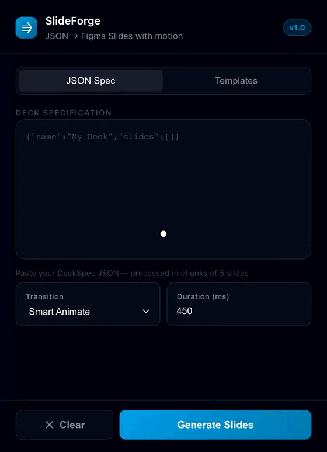

# SlideForge

**JSON to Figma Slides with SmartAnimate & motion graphics.**

<p align="center">
  
  <br />
  <sub>The plugin panel, recorded from the built <code>dist/ui.html</code> in a browser. The slides themselves are built inside Figma, which this clip does not show.</sub>
</p>

A Figma plugin that converts structured JSON deck specifications into fully built Figma Slide frames, complete with transitions, per-transition easing, and chunked processing for large decks.

## Features

- **JSON-driven slide generation** — Define slides, layers, text, shapes, and vectors via a typed DeckSpec schema
- **SmartAnimate transitions** — Automatic transition wiring between slides with matched layer names
- **Easing per transition** — Figma's built-in curves, a spring with your own mass, stiffness and damping, or a custom cubic-bezier. Listed transitions default to ease-in-out, 0.3 s; a deck with none is chained slide to slide at 450 ms
- **Chunked processing** — Batches of 5 slides to prevent memory saturation on large decks
- **Full Figma node support** — Frame, Text, Rectangle, Ellipse, Line, Star, Polygon, Vector, Group
- **Auto Layout** — Full auto-layout spec support (mode, alignment, padding, spacing, wrap)
- **Paint system** — Solid, linear/radial/angular/diamond gradients, image fills
- **Effects** — Drop shadow, inner shadow, layer/background blur
- **Mixed text segments** — Per-range font, size, color, decoration, hyperlinks
- **Design tokens** — Token resolution for colors and typography
- **4 built-in templates** — Hero Dark, Stats, Split Layout, CTA
- **Keyboard-friendly panel** — ARIA tabs and radio group, arrow keys to move between templates, Enter or Space to pick one, focus-visible rings, `prefers-reduced-motion` respected

## Quick Start

### 1. Clone & Install

```bash
git clone https://github.com/obeskay/slideforge.git
cd slideforge
npm install
```

### 2. Build

Needs Node 22.18 or newer, which runs `build.ts` with its built-in TypeScript support.

```bash
npm run build
```

This generates `dist/code.js` and `dist/ui.html`.

### 3. Load in Figma

1. Open Figma Desktop
2. Go to **Plugins > Development > Import plugin from manifest...**
3. Select the `manifest.json` file in this repo
4. Open the plugin from **Plugins > Development > SlideForge**

### 4. Use

- **JSON tab**: Paste a DeckSpec JSON and hit **Generate Slides**
- **Templates tab**: Pick a preset template (Hero Dark, Stats, Split, CTA)
- The panel's **Transition** and **Duration** fields set the slide-to-slide chain when the spec lists no `transitions`; listed transitions keep their own values

## DeckSpec Schema

```typescript
interface DeckSpec {
  name: string
  width?: number       // default 1920
  height?: number      // default 1080
  tokens?: DesignTokens
  slides: SlideSpec[]
  transitions?: TransitionSpec[]
}

interface SlideSpec {
  id: string
  name: string
  background?: Paint
  children: NodeSpec[]
}
```

See [`src/types/slide-spec.ts`](src/types/slide-spec.ts) for the complete typed schema.

## Project Structure

```
slideforge/
  manifest.json          # Figma plugin manifest
  build.ts               # esbuild bundler (code + UI inlining)
  package.json
  tsconfig.json
  src/
    code/index.ts        # Plugin sandbox entry (Figma API)
    core/
      slide-generator.ts # Main orchestrator (chunked processing)
      node-builder.ts    # NodeSpec -> Figma node converter
      paint-builder.ts   # Fill/stroke/effect applicator
      transitions.ts     # Easing presets + transition wiring
    types/
      slide-spec.ts      # Full TypeScript schema
    ui/
      index.html         # Plugin panel markup and styles
      index.ts           # UI logic (tabs, templates, progress)
    utils/
      color.ts           # Color utilities
      fonts.ts           # Font loading helpers
  dist/                  # Build output (gitignored)
    code.js
    ui.html
```

## Development

```bash
# Watch mode (auto-rebuild on changes)
npm run watch

# Type checking only
npm run typecheck

# Check that the panel's Transition and Duration reach the generated deck
npm run check

# Production build
npm run build
```

## Transition Types

| Type | Description |
|------|-------------|
| `SMART_ANIMATE` | Morphs matched layers between frames |
| `DISSOLVE` | Cross-fade between slides |
| `PUSH` | Pushes current slide out |
| `SLIDE_IN` | New slide enters from edge |
| `MOVE_IN` | New slide moves over current |
| `MOVE_OUT` | Current slide moves away |
| `SLIDE_OUT` | Current slide leaves toward an edge |
| `SCROLL_ANIMATE` | Scroll-style transition between frames |

## Easing

Set `easing.type` on a transition. Without one, the transition uses `EASE_IN_AND_OUT`.

| `easing.type` | Extra fields | Result |
|---------------|--------------|--------|
| `LINEAR`, `EASE_IN`, `EASE_OUT`, `EASE_IN_AND_OUT` | — | Figma's standard curves |
| `EASE_IN_BACK`, `EASE_OUT_BACK`, `EASE_IN_AND_OUT_BACK` | — | The same curves with a slight overshoot |
| `SPRING`, `CUSTOM_SPRING` | `spring: { mass, stiffness, damping }` | Custom spring; defaults 1 / 100 / 10 |
| `CUSTOM_BEZIER` | `bezier: { x1, y1, x2, y2 }` | Custom cubic-bezier; default 0.4, 0, 0.2, 1 |

## Tech Stack

- **TypeScript** — Strict mode
- **esbuild** — Fast bundling (IIFE format for Figma sandbox)
- **Figma Plugin API** — `@figma/plugin-typings`
- **No runtime dependencies** — Zero npm packages in production

## License

[MIT](LICENSE)
